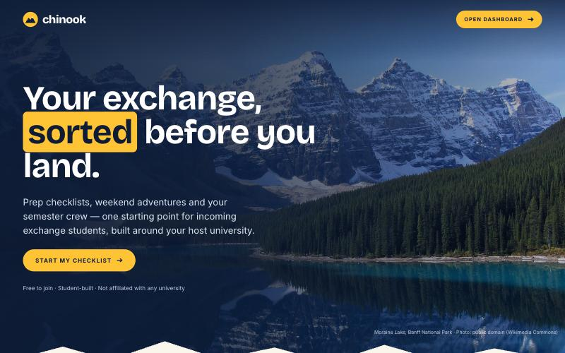
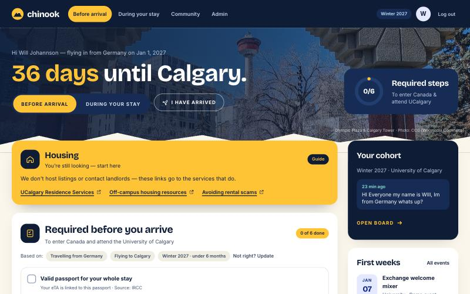
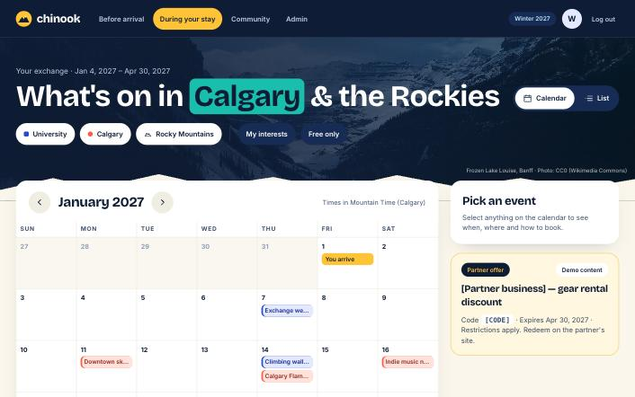
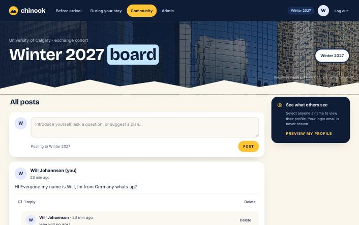
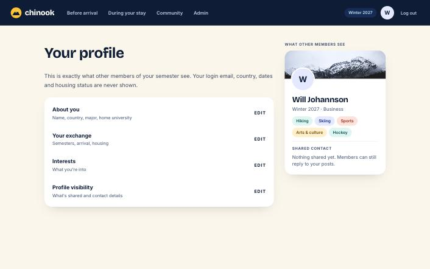
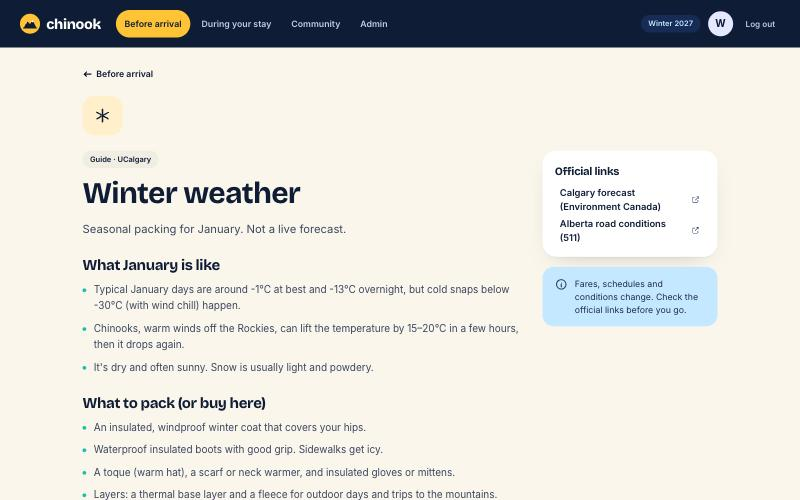
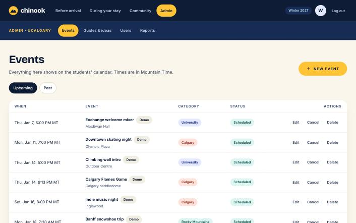

# chinook — your exchange, sorted before you land

**chinook** is a web app for incoming exchange students. It brings the three things they scramble for into one place:

1. **What should I prepare before coming?** A personalised checklist of required entry and study steps, plus housing, transport, phone and weather guides.
2. **What can I do once I arrive?** A curated calendar of university, Calgary and Rocky Mountain events, plus ongoing weekend activity ideas.
3. **Who else is here for my exchange?** A semester discussion board with opt-in member profiles.

It launches with the **University of Calgary**, and the data model already supports adding more universities. The name is a working title, after the warm winter wind that blows into Calgary off the Rockies.

> Built for **ENTI 333 (L02, Fall 2026) at the Haskayne School of Business, University of Calgary**, as the AI-assisted software development group project. It is a student project and is **not affiliated with or endorsed by the University of Calgary**.



---

## Contents

- [The problem](#the-problem)
- [Features](#features)
- [Screenshots](#screenshots)
- [Tech stack](#tech-stack)
- [Getting started](#getting-started)
- [Project structure](#project-structure)
- [Documentation](#documentation)
- [How we built it with AI](#how-we-built-it-with-ai)
- [Roadmap and known limitations](#roadmap-and-known-limitations)
- [Team](#team)
- [License](#license)

---

## The problem

Incoming exchange students have to piece their move together from dozens of sources: immigration pages, university housing sites, transit fares, phone plans, packing lists, event pages and informal group chats. The information is scattered. Much of it doesn't apply to their country or length of stay. And it's hard to meet the other students arriving in the same semester before they land.

chinook gives each student one personalised starting point. It doesn't replace official sources: it **links to them**, shows which steps apply to that student, and connects them with their semester cohort.

The full requirements are in the [product requirements document](docs/PRD.md). The problem framing, alternatives and customer discovery are in [docs/MARKET_RESEARCH.md](docs/MARKET_RESEARCH.md).

## Features

### For students

| Area | What it does |
|---|---|
| **Sign-up and onboarding** | A 4-step survey: about you, your exchange (semester, arrival date, housing), interests, and what's visible on your profile. No university email is needed, since many incoming students don't have one yet. |
| **Before arrival dashboard** | A countdown to arrival and a **rule-based required checklist** (for example, an eTA for German citizens, or medical insurance for stays under 12 months). Each item shows its official source. If a student's country hasn't been reviewed, the dashboard shows **"Requirements need confirmation"** and links to the official IRCC tool rather than guessing. |
| **Housing** | Students who are still looking see housing at the top of the dashboard. The links go to UCalgary Residence, off-campus resources and rental-scam guidance. The app never hosts listings. |
| **Helpful guides** | Transportation, winter weather, eSIM and phone, and useful apps. Each guide has its own page of practical information and official links. |
| **During your stay** | A month calendar and a list view of events, with filters for **University / Calgary / Rocky Mountains**, **My interests** and **Free only**. Each event has a detail panel showing when, where, organizer, price, transport, eligibility and booking links. All times are shown in Mountain Time. |
| **Activity ideas** | Ongoing ideas with no fixed date, such as a first ski day in Banff, the Johnston Canyon icewalk or a downtown river loop. They're kept separate from dated events so the app never invents a date. |
| **Partner offers** | Optional discount cards from local businesses, clearly labelled. |
| **Semester community** | A board per semester. Members can post, reply, link an event, report content and delete their own posts. |
| **Member profiles** | Each member chooses exactly what's shown: interests, home university, social handle, contact email or phone. The login email is never shown. A live preview shows "what other members see". |
| **Edit anything** | Click your avatar to open your profile, then edit any section. It saves and brings you straight back. |

### For administrators

| Area | What it does |
|---|---|
| **Events** | Add, edit, cancel, restore or delete events. Times are entered and shown in Mountain Time. |
| **Guides & ideas** | Create and edit guides and activity ideas: page text (simple `##` headings and `-` bullets), official links, icon, colour, photo and display order. |
| **Users** | Search members, suspend or unsuspend them, and grant or remove admin access. Admins can't see members' login emails. |
| **Reports** | A queue of reported posts and replies. Admins can hide the content, dismiss the report or suspend the author. |

### Privacy and safety by design

- **Row-level security** in Postgres enforces every rule in the database itself, not just in the UI. Students can only read their own profile row.
- Other members' profiles are read through a `member_profiles` view that only exposes the fields each owner switched on, and only to members of the same university.
- Admin rights are scoped per university, and users can't grant themselves admin.
- The app never collects passport numbers, document scans, visa files or home addresses.

## Screenshots

| Before arrival | During your stay |
|---|---|
|  |  |
| **Semester community** | **Profile and "what others see"** |
|  |  |
| **Guide detail** | **Admin console** |
|  |  |

## Tech stack

| Layer | Choice | Why |
|---|---|---|
| Framework | [Next.js 16](https://nextjs.org) (App Router, React 19, Server Components, Server Actions) | One codebase for pages and back-end logic. Forms work without client-side JavaScript. |
| Styling | [Tailwind CSS 4](https://tailwindcss.com) with design tokens from our mockups | Fast iteration that stays consistent with the mockup style. |
| Database and auth | [Supabase](https://supabase.com) (Postgres, Auth, row-level security) | A managed database and authentication service with a free tier, and privacy rules enforced in SQL. |
| Language | TypeScript, with database types generated from the schema | Catches schema mismatches at build time. |
| AI tooling | Claude (ideation, PRD, mockups) and **Claude Code** (main development) | See [How we built it with AI](#how-we-built-it-with-ai). |

Architecture details are in [docs/ARCHITECTURE.md](docs/ARCHITECTURE.md).

## Getting started

### Prerequisites

- Node.js 20 or newer
- A free [Supabase](https://supabase.com) project
- The [Supabase CLI](https://supabase.com/docs/guides/cli) (only needed to set up or change the database)

### 1. Install

```bash
git clone https://github.com/Will-Click/exchange-app.git
cd exchange-app
npm install
```

### 2. Create the database

Link your Supabase project, then push the schema, seed data and content:

```bash
supabase link --project-ref <your-project-ref>
supabase db push --include-seed
supabase config push
```

`config push` applies the auth settings in `supabase/config.toml`: email confirmation is off, and the minimum password length is 8.

### 3. Configure environment variables

```bash
cp .env.example .env.local
```

Fill in `NEXT_PUBLIC_SUPABASE_URL` and `NEXT_PUBLIC_SUPABASE_PUBLISHABLE_KEY`. Find them in the Supabase dashboard under **Project Settings → API**. `.env.local` is gitignored and must never be committed.

### 4. Run

```bash
npm run dev
```

Open http://localhost:3000 and click **Sign up**.

### 5. Make yourself an admin

The first account is a regular student. To unlock the **Admin** tab, run:

```bash
supabase db query --linked "insert into public.admins (user_id, university_id) select id, '00000000-0000-4000-8000-000000000001' from auth.users where email = 'YOUR_EMAIL';"
```

### Useful scripts

| Command | What it does |
|---|---|
| `npm run dev` | Start the development server |
| `npm run build` | Production build |
| `npm run lint` | ESLint |
| `npm run typecheck` | TypeScript check |
| `supabase gen types typescript --linked > src/lib/database.types.ts` | Regenerate database types after a schema change |

> **Free plan note:** Supabase pauses free projects after a week with no activity. To resume, open the project in the dashboard and click **Restore**.

## Project structure

```
src/
  app/
    page.tsx               Landing page
    login/, onboarding/    Log in and the 4-step sign-up (step 1 creates the account)
    dashboard/             Before arrival: countdown, required checklist, housing, guides
    guides/[slug]/         Guide detail pages
    events/                Calendar and list, filters, event details, activity ideas
    events/ideas/[id]/     Activity idea detail pages
    community/             Semester board: posts, replies, reports, member profiles
    profile/               Your profile, with "what others see" preview
    admin/                 Admin console: events, guides & ideas, users, reports
    actions/               Server Actions (every write goes through here)
  components/              Header, profile card, detail page layout, icons, inputs
  lib/                     Supabase client, data helpers, time zones, constants, brand name
  proxy.ts                 Session refresh and sign-in redirects (Next.js 16 "proxy", formerly middleware)
supabase/
  migrations/              Schema, row-level security policies and views
  seed.sql                 UCalgary, 2027 semesters, checklist rules, guides, demo events
  content.sql              Guide and activity-idea page content
docs/                      PRD, architecture, AI development log, market research, screenshots
```

## Documentation

| Document | Contents |
|---|---|
| [docs/PRD.md](docs/PRD.md) | Product requirements document: users, scope, requirements, acceptance criteria, success measures |
| [docs/MARKET_RESEARCH.md](docs/MARKET_RESEARCH.md) | Problem hypothesis, existing alternatives, differentiation, customer discovery |
| [docs/ARCHITECTURE.md](docs/ARCHITECTURE.md) | System design, data model, security model, routes, key decisions |
| [docs/AI_DEVELOPMENT.md](docs/AI_DEVELOPMENT.md) | How AI tools were used, with example prompts, what worked and what didn't |

## How we built it with AI

We used AI at every stage, with a person making the product decisions:

1. **Ideation and requirements.** We used Claude to pressure-test the idea and draft the [PRD](docs/PRD.md): scope, privacy rules, acceptance criteria and what to leave out of the MVP.
2. **Design.** Claude generated clickable mockups, and their colours, type and components became the app's design tokens.
3. **Development.** We used **Claude Code**, an agentic AI coding tool that works directly in the repository and terminal. It chose the architecture, wrote the schema and row-level security policies, built every page, set up the hosted Supabase database, tested flows in a browser and committed to GitHub.
4. **Documentation.** This README and the docs folder were written with Claude Code from the code and git history.

Example prompts, the iteration loop and lessons learned are in [docs/AI_DEVELOPMENT.md](docs/AI_DEVELOPMENT.md).

## Roadmap and known limitations

The MVP covers the PRD's core journey. Not built yet:

- Email verification and password reset. Email sending was deliberately left out of the first version.
- Account deletion, post editing, post categories and tags, and posting rate limits.
- Archiving finished semester boards as read-only.
- Marking a checklist item as "not applicable".
- Photo upload for activity ideas (they currently choose from the bundled photos).
- Deployment to Vercel. It runs locally against a hosted Supabase database.
- Multiple universities in the interface. The data model already supports them.

## Team

ENTI 333 L02, Fall 2026:

- Will Johannson — project owner
- *Add team members here*

## License

[MIT](LICENSE). Photos in `public/photos` are public domain or CC0 from Wikimedia Commons, and their credits are shown in the app.
