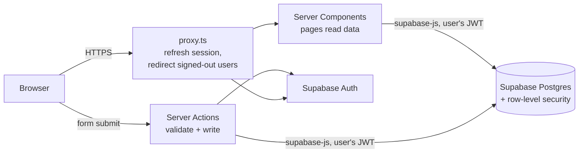

# Architecture

chinook is a single Next.js application backed by a managed Supabase project. There's no separate API server: pages are React Server Components that read from Postgres, and every write goes through a Server Action. Authorization is enforced **in the database** with row-level security (RLS), so a bug in the UI can't leak another student's private data.

## Request flow

1. **`src/proxy.ts`** runs on every request. Next.js 16 renamed middleware to "proxy". It refreshes the Supabase session cookie and sends signed-out visitors away from `/dashboard`, `/events`, `/guides`, `/community`, `/profile`, `/admin` and the onboarding steps.
2. **Pages** call `requireMember()` (`src/lib/data.ts`), which loads the viewer's profile, semesters, university and admin flag. It sends unfinished sign-ups back to their onboarding step and suspended users to `/suspended`.
3. **Reads** use the Supabase client created per request with the user's cookies (`src/lib/supabase/server.ts`). Every query runs as that user, so RLS decides what comes back.
4. **Writes** are Server Actions in `src/app/actions/`:
   - `auth.ts`: log in, log out, the four onboarding/profile steps
   - `app.ts`: checklist ticks, "I have arrived", posts, replies, reports, joining a semester
   - `admin.ts`: events, guides, activity ideas, users, reports. Each action re-checks admin rights, and RLS checks them again.

The app uses the public "publishable" key only. No service-role key exists in the app or the repo.

## Data model

All content tables carry a `university_id`, which is how one deployment can serve several universities.

| Table / view | Purpose |
|---|---|
| `universities` | Host universities, including `reviewed_countries` (the countries whose checklist rules have been verified) |
| `terms` | Semesters (e.g. Winter 2027), each with dates and an `is_open` flag for sign-up |
| `profiles` | One row per user: names, country, exchange details, interests, visibility switches, onboarding state, suspension. Created by the `handle_new_user` trigger. |
| `profile_terms` | Which semester boards a member belongs to (a member can be in more than one) |
| `admins` | Per-university admin grants |
| `checklist_items` | Required steps, each with an `applies_to` rule such as `{"home_countries":["Germany"]}` or `{"stay":"short"}`, plus source and review date |
| `checklist_progress` | Which items each student has ticked |
| `guides` | Before-arrival guides: summary, page body, links, icon, colour, order |
| `events` | Dated events with category (`university` / `city` / `rockies`), status (`scheduled` / `canceled`), price, transport, eligibility, tags, booking and source links |
| `activity_ideas` | Undated ideas, kept separate from events so no date is invented |
| `partner_offers` | Optional partner discounts with expiry and a demo label |
| `posts`, `replies` | Semester-board content, with a `hidden_at` timestamp for moderation |
| `reports` | Member reports and their resolution |
| `member_profiles` (view) | What one member may see about another (see below) |

Migrations live in `supabase/migrations/`. Seed data (UCalgary, semesters, checklist rules, demo events) is in `supabase/seed.sql`, and the guide and idea page text is in `supabase/content.sql`.

## Security and privacy model

| Rule | How it's enforced |
|---|---|
| A student can read and change only their own profile | RLS on `profiles` (`id = auth.uid()`) |
| Other members see only what each person chose to share | The `member_profiles` view returns NULL for every field whose `show_*` switch is off, and only returns members of the viewer's university. Login email and private fields aren't in the view at all. |
| Only members of a semester can read its board | RLS on `posts` / `replies` uses `is_term_member(term_id)` |
| Only authors can delete their own posts | RLS `author_id = auth.uid()` |
| Admins manage only their own university | `is_admin(university_id)`, checked in RLS and again in each admin Server Action |
| A user can't make themselves admin or lift their own suspension | There's no insert policy on `admins` for non-admins, and the `guard_profile_update` trigger blocks non-admins from changing `suspended_at` |
| Signed-out visitors can't read any member data | All policies are `to authenticated`, and the proxy redirects signed-out visitors |

These rules were tested during development by signing in as a student and trying each forbidden action directly against the database: reading another profile, adding an event, suspending a user and granting admin. All were refused.

## Time zones

Every event is stored as a UTC `timestamptz` and shown in **America/Edmonton** (Mountain Time), including daylight-saving changes. Admins type local times, and `src/lib/time.ts` converts them in both directions with `Intl`, so the result doesn't depend on the server's time zone.

## Checklist rules

`itemApplies()` in `src/lib/data.ts` checks each `applies_to` rule against the student's home country and stay length. Stay length is "short" when their semesters span six months or less. If the student's country isn't in `universities.reviewed_countries`, the dashboard deliberately shows **"Requirements need confirmation"** with a link to the official IRCC tool. The app never guesses immigration requirements.

## Styling

Design tokens from the mockups, such as `navy`, `sun`, `teal`, `glacier` and `cream`, are defined with Tailwind 4 `@theme` in `src/app/globals.css`. A small set of component classes (`.btn`, `.card`, `.chip`, `.inp`, `.tab` and so on) carry the mockup styles. The product name lives in one constant, `src/lib/brand.ts`.

## Key decisions

| Decision | Why |
|---|---|
| Next.js Server Actions instead of a REST API | Less code. Forms work without client JavaScript. Validation stays on the server. |
| Authorization in Postgres RLS | One source of truth for privacy that can't be bypassed by a missed check in the UI |
| Supabase free plan | Managed Postgres and Auth at no cost. Its spend cap stops any billing. |
| No email sending in the MVP | Keeps the scope down and avoids email costs. Email confirmation is off in `supabase/config.toml`. |
| Content in the database, not in code | Admins can update guides, ideas and events without a deploy |
| `cacheComponents: false` | Nearly every page depends on the signed-in user, so pages render per request |
